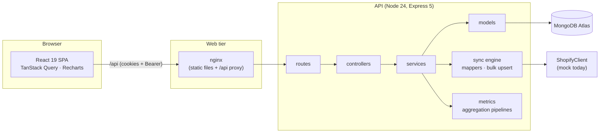

# ProfitHQ

A full-stack analytics dashboard that tells Shopify merchants their **true net profit**: revenue
minus discounts, refunds and the actual cost of the goods sold, not just sales.

It is a portfolio project, so it uses **simulated Shopify data** (a deterministic mock that
returns payloads shaped like the Admin GraphQL API). There is no real Shopify connection yet;
the client sits behind an interface so a real one can be swapped in.

<!--
Screenshots: add docs/screenshots/dashboard.png and docs/screenshots/dashboard-dark.png, then
replace this comment with:


-->

## Features

- **Net profit dashboard**: gross revenue, COGS, net profit with net margin, and average order
  value, each compared with the previous period (7, 30 or 90 days). Filters live in the URL.
- **Trend chart**: net revenue and net margin per day or month in the store's time zone, with
  gaps filled, a tooltip and a data table fallback.
- **Idempotent sync engine**: import products and orders as often as you like; the result is
  always the same (no duplicates, no needless writes). Resumes after a failure, and one sync runs
  per store at a time.
- **COGS snapshot**: the product cost is frozen on each order line when it is synced, so
  changing a cost later never rewrites past profit.
- **Dead-stock planner**: in-stock variants that have not sold for 30, 60 or 90 days, sortable
  and paginated, with the capital tied up in them. Computed on read from the orders, so it is
  always consistent with the latest sync.
- **Holding cost calculator**: the monthly cost of keeping that stock, from a per-store rate
  (default 2% of stock value per month) that you edit inline.
- **Smart markdowns**: a suggested 15%, 30% or 50% discount by how long a variant has been idle,
  with the new price and a warning, readable without color, when it would sell below cost.
- **Secure authentication**: short-lived access token kept in memory plus a rotating refresh
  token in an `httpOnly` cookie, with reuse detection.
- **Accessible, themeable UI**: keyboard focus, live-region sync status, dark mode that follows
  the system.

Planned next: customer retention segments, real Shopify OAuth.

## Architecture



- **Backend layering** is `routes → controllers → services → models`. Controllers only translate
  HTTP; business logic lives in services. Errors are `AppError`s rendered in one envelope
  (`{ error: { code, message, details?, requestId } }`); request input goes through Zod.
- **Sync** pulls pages from the `ShopifyClient`, maps them to internal documents (money in
  integer cents, COGS looked up from product costs), diffs them by content hash and writes them
  with batched upserts. See [docs/sync.md](docs/sync.md).
- **Metrics** are computed in MongoDB with single-pass aggregation pipelines over indexed
  orders, then derived in plain tested code. See [docs/metrics.md](docs/metrics.md).
- Decisions and their trade-offs are recorded in [docs/adr](docs/adr/README.md); the security
  review is in [docs/security.md](docs/security.md).

### Tech stack

| Layer    | Technology                                                                                 |
| -------- | ------------------------------------------------------------------------------------------ |
| Frontend | React 19, TypeScript, Vite, Tailwind CSS 4, TanStack Query, React Router, Recharts         |
| Backend  | Node 24, Express 5, TypeScript (NodeNext ESM), Mongoose 9, Zod 4, pino, argon2, jose       |
| Database | MongoDB (Atlas)                                                                            |
| Quality  | Vitest, Supertest, Testing Library, ESLint (type-aware), Prettier, Husky + lint-staged, CI |
| Delivery | Docker (multi-stage), nginx, GitHub Actions                                                |

## Getting started

Requirements: **Node >= 22.12** (`.nvmrc` pins 24) and a **MongoDB Atlas** database (there is no
local Mongo setup).

```sh
git clone <this repo> && cd profit_hq
npm install

cp backend/.env.example backend/.env       # then fill in MONGODB_URI and the two JWT secrets
cp frontend/.env.example frontend/.env     # the defaults work for local development
```

Generate each JWT secret (they must differ, 32+ characters):

```sh
node -e "console.log(require('crypto').randomBytes(64).toString('hex'))"
```

Then:

```sh
npm run seed    # optional: demo account demo@profithq.dev / demo-password-123 with synced data
npm run dev     # API on :4000, web app on :5173 (Vite proxies /api to the API)
```

Open http://localhost:5173, register (or use the seeded demo account), and click **Sync now**.
API documentation (Swagger UI): http://localhost:4000/api/docs.

### Scripts

Run from the repository root.

| Command                                                       | What it does                                                      |
| ------------------------------------------------------------- | ----------------------------------------------------------------- |
| `npm run dev`                                                 | API and web app together, with reload                             |
| `npm run build`                                               | Type-check and build both workspaces                              |
| `npm run typecheck` · `npm run lint` · `npm run format:check` | The static checks CI runs                                         |
| `npm test`                                                    | Backend and frontend tests (see below)                            |
| `npm run seed`                                                | Create the demo account and sync mock data into your dev database |
| `npm run dev -w backend`                                      | One workspace only                                                |

### Environment variables

Validated at startup (`backend/src/config/env.ts`); the API refuses to start on a bad value.

| Variable                 | Default                 | Meaning                                                                                |
| ------------------------ | ----------------------- | -------------------------------------------------------------------------------------- |
| `MONGODB_URI`            | required                | Atlas connection string, including the database name                                   |
| `MONGODB_URI_TEST`       | empty                   | A **separate** database for tests; database tests are skipped while empty              |
| `JWT_ACCESS_SECRET`      | required                | Signs access tokens (32+ characters)                                                   |
| `JWT_REFRESH_SECRET`     | required                | Keys the refresh-token hash (32+ characters, different from the access secret)         |
| `CLIENT_ORIGIN`          | required                | Origin of the web app, used for CORS and the cookie origin check                       |
| `PORT`                   | `4000`                  | API port                                                                               |
| `NODE_ENV`               | `development`           | `production` also turns on the `Secure` cookie flag                                    |
| `LOG_LEVEL`              | `info`                  | pino level                                                                             |
| `JWT_ACCESS_TTL`         | `15m`                   | Access token lifetime (`30s`, `15m`, `2h`, `1d`)                                       |
| `REFRESH_TOKEN_TTL_DAYS` | `7`                     | Refresh token lifetime                                                                 |
| `COOKIE_SECURE`          | on in production        | Send the refresh cookie over https only; set `false` to try a production build on http |
| `SEED_EMAIL`             | `demo@profithq.dev`     | Demo account for `npm run seed`                                                        |
| `SEED_PASSWORD`          | `demo-password-123`     | Its password                                                                           |
| `VITE_API_BASE_URL`      | `/api`                  | (frontend) API base URL; keep `/api` unless the API is on another origin               |
| `DEV_API_PROXY_TARGET`   | `http://localhost:4000` | (frontend, dev only) where Vite proxies `/api`                                         |

## Testing

```sh
npm test
```

- **Backend** (Vitest + Supertest): unit tests for mappers, hashing, date ranges and metric
  maths; HTTP tests for auth (including refresh-token reuse detection, injection and CORS) and
  store access; database tests for the sync invariants and the aggregation pipelines against
  hand-computed fixtures.
- **Frontend** (Vitest + Testing Library): the sync state machine, number formatting, metric
  cards, route guards and the sync controls, plus the dead-stock page (URL-synced window
  filter, markdown badges, holding cost rate form, table and states).

Tests that need MongoDB use the database in `MONGODB_URI_TEST`, never the development one, and
skip themselves while it is empty, so a fresh clone can still run `npm test`.

## Docker

```sh
cp backend/.env.example backend/.env   # MONGODB_URI and the JWT secrets
docker compose up --build              # http://localhost:8080
```

Two images: the API (`backend/Dockerfile`) and the web app behind nginx (`frontend/Dockerfile`),
which also proxies `/api` to the API so the browser sees a single origin. MongoDB is not part of
the compose file; it stays on Atlas. The compose file turns `COOKIE_SECURE` off because the demo
is served over plain http; a real deployment must sit behind https and leave it on.

## API summary

Full, always up-to-date reference: **`/api/docs`** (Swagger UI) or `/api/openapi.json`. The request
schemas are generated from the same Zod schemas the routes validate with.

| Method and path                            | Purpose                                                                                 |
| ------------------------------------------ | --------------------------------------------------------------------------------------- |
| `POST /api/auth/register` · `login`        | Create an account / sign in; sets the refresh cookie                                    |
| `POST /api/auth/refresh` · `logout`        | Rotate the session / end it                                                             |
| `GET /api/auth/me`                         | The signed-in user                                                                      |
| `GET /api/stores`                          | Your stores                                                                             |
| `POST /api/stores/:id/sync`                | Start a sync (`202`; `409` if one is running)                                           |
| `GET /api/stores/:id/sync/latest`          | Latest sync run, for polling                                                            |
| `GET /api/stores/:id/metrics/summary`      | `?range=7d\|30d\|90d` headline metrics with previous period                             |
| `GET /api/stores/:id/metrics/trend`        | `?range=…&granularity=day\|month` series, gaps filled                                   |
| `GET /api/stores/:id/inventory/dead-stock` | `?window=30\|60\|90` dead variants with holding cost and markdown, sorted and paginated |
| `PATCH /api/stores/:id/settings`           | Change store settings (the holding cost rate)                                           |
| `GET /api/health`                          | Liveness and database status                                                            |

Money is always integer cents in the store's currency; ratios are plain numbers (0.25 = 25%).

## Project structure

```
backend/src
  config/        validated env, logger
  routes/ controllers/ services/ models/   the request path, in layers
  middleware/    auth, validation, rate limits, error handling
  sync/          mappers, content hash, bulk upsert, COGS reconcile
  metrics/       aggregation pipelines and the maths on their results
  inventory/     dead-stock report, holding cost and markdown tiers (pure code + last-sale pipeline)
  shopify/       ShopifyClient interface, Zod payload schemas, deterministic mock
  openapi/       API description and Swagger UI routes
  scripts/       seed
frontend/src
  app/           providers, router, query client
  features/      auth, stores, metrics, inventory, sync (hooks, API calls, state machine)
  components/    layout, dashboard, inventory, ui primitives
docs/            metrics, dead-stock, sync, security, architecture decisions
```

## Documentation

- [docs/metrics.md](docs/metrics.md): exact definitions of every number on the dashboard
- [docs/dead-stock.md](docs/dead-stock.md): dead stock, holding cost and markdown definitions
- [docs/sync.md](docs/sync.md): the sync engine and its idempotency invariant
- [docs/security.md](docs/security.md): security review, controls and accepted risks
- [docs/adr](docs/adr/README.md): architecture decision records

## License

No license has been chosen yet.
